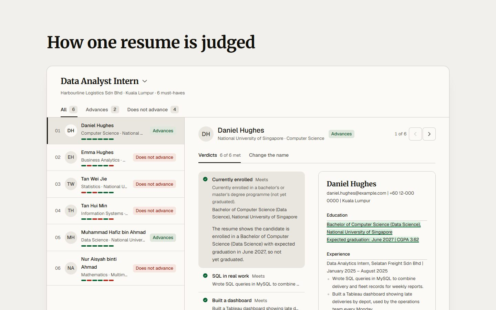
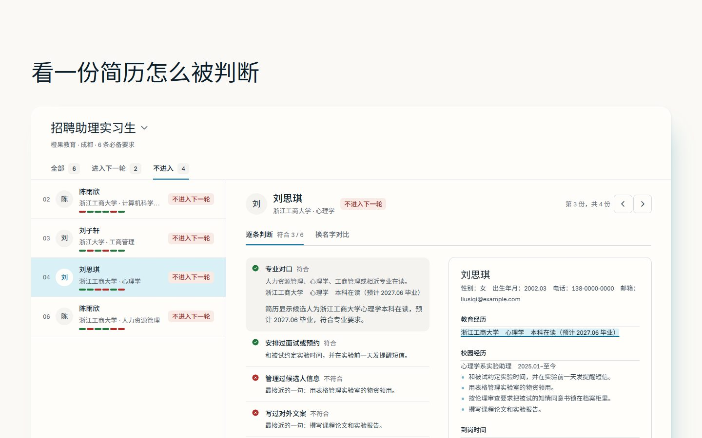

# Evidence Screening

Resume screening with a language model, where every "meets" points to the line of the resume behind it, checked word for word by a script. Five rounds of tests on fictional jobs and resumes show what that adds, what the check stops and what it does not, and whether the conclusions move with names, gender or other signals that have nothing to do with the job.

**Try it:** [llia0031-dotcom.github.io/evidence-screening](https://llia0031-dotcom.github.io/evidence-screening/), the stored outputs in an applicant-tracking view. It makes no model calls.

[中文](#中文)

## What the tests found

All on fictional resumes with the answers fixed when they were written, one model (Claude Haiku 5.5), every model test run twice. Plans and predictions were fixed before each run. Full report: [`eval/EVALUATION.md`](eval/EVALUATION.md).

- **A quote for every verdict removed the one systematic misreading.** Without quotes, 2,728 of 2,736 verdicts matched the answer key, and all eight misses read "graduating June 2026" as still enrolled. With quotes: 2,735 of 2,736.
- **A quote check has to check only the resume's own facts.** Checking a sentence that restated the job's thresholds threw away 17% of correct verdicts on new resumes; checking only the resume fact, and letting the model run the check before it answers, brought that to 0, at about twice the cost.
- **The check stops made-up evidence, not misreadings.** Answers changed so that a quote lost a word, came from another resume, or gained a figure the resume never gives were all stopped (1,212 of 1,212); a figure changed by one was stopped 201 of 229 times. Wrong readings of real quotes all passed (0 of 40). A second review of each "meets" caught 159 of those 160 misreadings over two review styles and two runs, and flagged none of the 103 right answers in 412 reviews.
- **Decisions did not move with names, gender or indirect markers.** Changing the name and gender changed no decision (0 of 240). In anonymised resumes with markers of ethnicity and gender (languages, clubs, hobbies), the plain prompt changed no decision (0 of 288); the quoting prompt's five changes trace to one wavering answer on a borderline resume.
- **A lower effort did not make the model err.** Rerun at effort `low`, it again fell for none of the 40 traps, so how often the check and the review stop a model's own mistakes is still unmeasured.
- **Scores moved by a few points.** On the Chinese resumes, adding any activities section lowered every group's score, so decisions should rest on the verdicts, not on the score.

## Screenshots

The stored outputs shown the way an applicant tracking system shows a job: one job per page, the candidates in a list, and each verdict beside the resume line it rests on. The page makes no model calls.





## Where this fits

This is one of a set of projects built on one idea: every claim an AI makes should point to its source, and every change to an AI step should come with evaluation evidence. Among the projects that judge, it is the first step: a single verdict, backed by one line of the resume. The next steps [judge a product claim against many customer reviews](https://github.com/llia0031-dotcom/sellpoint-check) and [review ads over several turns with tools](https://github.com/llia0031-dotcom/grounded-review).

The quote check is the script from [evidence-check](https://github.com/llia0031-dotcom/evidence-check), used as a frozen copy of version 0.2.0 ([`eval/frozen/check_evidence.py`](eval/frozen/check_evidence.py)), so that results do not move when the script changes.

## What is here

| Folder | What it holds |
|---|---|
| `data/` | Four fictional jobs and the test resumes of each round, with their answer keys |
| `eval/` | The report, the plan fixed before each run, the scripts, and every stored model output |
| `demo/` | The page linked above (Vite and React). It reads the stored outputs in `demo/src/data/` and makes no model calls |
| `guide/` | A one-page guide in Chinese: how to use AI screening so that it holds up |

## Run it

Scoring and the demo need no API key:

```bash
python eval/score.py --check
python eval/v4/score.py eval/v4/results/run-2026-11-14.jsonl
cd demo && npm install && npm run build && npm run preview
```

A new run needs an Anthropic API key in a `.env` file and Node 22 or later; see the run command in each round's `PREREGISTRATION.md`.

## Limits

The jobs and resumes are fictional, short and written by the same author as the answer key, which is why accuracy is near 100%. One model was tested, at effort medium (low in round five). The misreadings in the review test were written in, not produced by a model. See the Limits section of the report.

## Credits and licences

This repository is released under the MIT License (`LICENSE`). Parts copied from others keep their own licences, listed in `THIRD_PARTY_NOTICES.md`.


- Score-only prompt: PopResume (arXiv 2603.22714, MIT), copied word for word in `eval/run.mjs`; licence in `eval/third_party/popresume/`. `keyword_in_text`: Resume-Matcher (Apache-2.0), copied with its licence in `eval/third_party/resume_matcher/`.
- Quote check: a frozen copy of evidence-check 0.2.0 (MIT), licence in `eval/frozen/`.
- Name-swap design: Wilson & Caliskan (AIES 2024) and FAIRE (arXiv 2504.01420); no code or name lists copied.
- English markers of ethnicity and gender in v4: Tan et al., "Small Changes, Big Impact" (EMNLP 2026, arXiv 2603.05189), github.com/Social-AI-Studio/LLMHiringFairnessSG, CC-BY-4.0.
- Rule-based error seeding after FactCC (EMNLP 2020); review without seeing the earlier answer after factored Chain-of-Verification (arXiv 2309.11495). No code copied.
- Demo fonts: Merriweather, Geist, Noto Serif SC and Noto Sans SC through Fontsource (SIL Open Font License 1.1). Icons: Phosphor (MIT).

## 中文

用大模型初筛简历：每一个“符合”都附上简历原文，由脚本逐字核对。五轮测试用的都是虚构岗位和简历，答案在写简历时就定好；看附原文带来了什么、核对能拦住什么拦不住什么，以及结论会不会随名字、性别和与工作无关的线索变化。

- 附原文后，2,736 个判断只错 1 个；不附原文错 8 个，全是把“2026.06 毕业”读成还在读。
- 核对只能核对简历本身的事实：连复述的岗位门槛一起核对，新简历上会误伤 17% 的正确判断；只核对简历事实、交卷前先自查，降到 0，费用约两倍。
- 核对拦得住编造的证据：引文少一个字、搬别的简历的句子、添简历里没有的数字，1,212 处全部拦下；数字只改大 1 的，拦下 201/229。拦不住引文是真的、意思看错了的错判（40 条一条没拦住）；对每条“符合”再复核一次，160 次里挑出 159 次，103 条正确答案复核 412 次，没有一次被误判。
- 换名字和性别，去留一次都没变（0/240）；隐去名字、只加语言和社团线索，只给结论的做法去留也没变（0/288），附原文的做法变了 5 次，都出在同一份答案摇摆的简历上。
- 把 effort 调低到 low 再跑，40 个陷阱仍然一个都没上当，所以核对和复核能拦住模型自己多少错，还没测到。
- 分数会动几分：中文简历加任何一节活动经历，各组分数都降，所以去留要看逐条判断，不看分数。

在线试用：[llia0031-dotcom.github.io/evidence-screening](https://llia0031-dotcom.github.io/evidence-screening/)，页面显示测试时存下的结果，不调用模型。

**这个项目的位置**：这是“让 AI 拿出证据”这组项目里判断类场景的第一步，一条判断附一句简历原文；后面依次是[用上百条评价证实一条卖点](https://github.com/llia0031-dotcom/sellpoint-check)、[多轮调用工具的广告审核 Agent](https://github.com/llia0031-dotcom/grounded-review)。核对用的是 [evidence-check](https://github.com/llia0031-dotcom/evidence-check) 的脚本，固定用 0.2.0 版的冻结副本，结果不会随脚本更新而变。

给招聘团队的做法：[`guide/AI初筛怎么用才稳.md`](guide/AI初筛怎么用才稳.md)。
